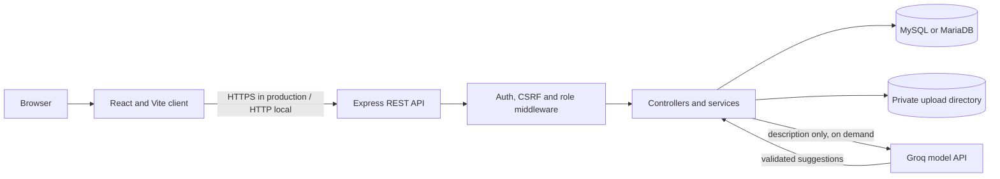

# System Architecture

## Components

- **Browser client:** React/Vite single-page application. React Router maps public, citizen, CMO, and officer pages. Axios sends credentialed API requests. `AuthContext` keeps the safe user profile and CSRF token in memory; it does not store the JWT in web storage.
- **Express API:** `server/src/app.js` mounts health, department, auth, user, access, grievance, CMO, and officer routers. Controllers shape HTTP responses; services implement parameterized SQL and workflow transactions.
- **MySQL-compatible database:** shared `mysql2/promise` pool. Ordered SQL files under `server/database/migrations` are tracked in `schema_migrations`. Reference data is inserted by `001_reference_data.sql`.
- **Private file storage:** uploads are validated in memory, signature checked, stored with generated names beneath `UPLOAD_DIR` (default `server/uploads`), and retrieved only through authorization-controlled endpoints. Files are not statically served.
- **AI provider:** the backend sends complaint description text to Groq only when a citizen or CMO requests analysis. It returns validated suggestions and does not update grievance fields.

## Client and server request flow

The client obtains a signed CSRF token from `GET /api/auth/csrf`, then restores an existing session through `GET /api/auth/me`. For login, registration, and other state-changing requests, Axios sends the CSRF token in `X-CSRF-Token`; the JWT is in an HttpOnly cookie. The server applies credentialed CORS for the configured `CLIENT_URL`, body limits, cookie parsing, CSRF checks, and centralized safe errors.

The API authenticates the JWT, reloads the active user and role from MySQL, then applies role checks. SQL calls use bound parameters. Multi-record grievance actions use transactions and write status history with the actor and database timestamp.

## Authentication, authorization and cookies

Passwords are bcrypt hashes. JWTs use HS256, fixed issuer/audience, subject and role claims, and configured expiration. The session cookie is HttpOnly, host-only, and Secure in production. Local development uses `AUTH_COOKIE_SECURE=false` and `AUTH_COOKIE_SAME_SITE=lax`; HTTPS deployments require Secure cookies. Configure `SameSite=None` only when a cross-site frontend/API deployment requires it, together with Secure.

The CSRF token is signed and bound to the session cookie. Unsafe API methods require matching CSRF cookie/header and check Origin when present. Backend middleware, not frontend route guards, enforces the three roles.

## Database and migrations

`server/src/config/env.js` loads the project-root `.env` through a path relative to the config module. `server/src/config/database.js` creates the pool. `npm run db:migrate` creates the configured database if permitted and applies migrations 001–004 in order, recording each in `schema_migrations`. `npm run db:seed` inserts fictional districts and departments idempotently. Demo accounts are provisioned separately. See [Database Design](03_Database_Design.md) and [Setup and Testing](06_Setup_and_Testing.md).

## Grievance, assignment and file flow

Citizen submission writes the grievance, its initial status event, and attachment metadata in a transaction. The CMO reviews and assigns a grievance; the API verifies the chosen officer is active and belongs to the selected department. Assignment and status history are retained. Officers submit report versions; CMO approval or request-for-changes is recorded, and approval updates the grievance to Resolved transactionally. The CMO may reopen a resolved case while preserving prior history.

Attachment uploads accept up to five PDF/JPG/PNG files, limited to 5 MB each, with MIME/signature checks. Files remain under a private directory; database rows store metadata and authorized download routes enforce access.

## AI service flow and safeguards

The citizen endpoint analyzes an unsaved description; the CMO endpoint loads the stored case description. The server obtains allowed department/category values, requests strict structured output from Groq, and validates the response. Only the description is sent to the provider. The UI labels suggestions for human review, and AI cannot make assignments, set status, or resolve cases. Details are in [AI Integration](05_AI_Integration.md).

## Current public-site limitation

Dedicated About, How It Works, Departments, Contact, and FAQ pages are not implemented. The home page has brief About/How It Works sections and a small live department preview; its Contact link is a placeholder. The database has a `contact_enquiries` table, but there is no contact submission API.
