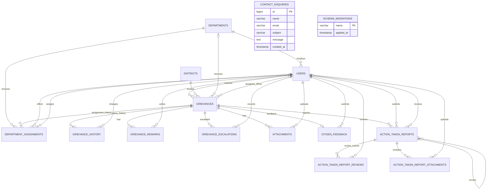

# Database Design

## Conventions

The assessment targets MySQL 8; database verification ran against XAMPP MariaDB 10.4.32. Tables use InnoDB, `utf8mb4` and `utf8mb4_unicode_ci`, selected because MariaDB 10.4 does not support `utf8mb4_0900_ai_ci`. Tables use unsigned auto-increment integer primary keys, explicit foreign keys and indexes. Record deletion is restricted where it could erase grievance traceability; optional assignment references use `SET NULL`. Database migrations are additive and use `CREATE TABLE IF NOT EXISTS`.

## Entity relationship diagram

`contact_enquiries` has no foreign-key relationship. `schema_migrations` is shown for completeness as a migration ledger, not as an application entity.

## Tables

| Table | Fields and constraints |
|---|---|
| `users` | `id` BIGINT PK; `name` VARCHAR(160); `email` VARCHAR(254) unique; `mobile` VARCHAR(20); `password_hash` VARCHAR(255); `role` enum (`citizen`, `cmo_admin`, `department_officer`); nullable `department_id` FK; `is_active` BOOLEAN; `created_at`, `updated_at` timestamps. Department deactivation is represented by the related user's `is_active`; deleting a department clears this optional link. |
| `departments` | `id` INT PK; unique `name` VARCHAR(160); `description` VARCHAR(500); `created_at`. |
| `districts` | `id` SMALLINT PK; unique `name` VARCHAR(80). Additional normalized lookup required to seed and constrain the fourteen districts. |
| `grievances` | `id` BIGINT PK; unique `reference_number` VARCHAR(32); `citizen_id` FK; `district` VARCHAR(80) FK to `districts.name`; `category`, `subject`, `description`; `priority` enum Low/Medium/High; `status` enum Submitted/Under Review/In Progress/Resolved/Reopened; nullable AI department/category/priority/summary fields; nullable assigned department/officer FKs; nullable `due_at`, `resolved_at`; `created_at`, `updated_at`. AI suggestions are distinct from administrative assignments. |
| `grievance_history` | `id` BIGINT PK; `grievance_id` FK; nullable `previous_status`; required `new_status`; nullable `remarks`; `citizen_visible` BOOLEAN (added by migration 002, defaults false); required `changed_by` user FK; `created_at`. Citizen detail/tracking APIs only return visible entries. Indexed by grievance and time. |
| `department_assignments` | `id` BIGINT PK; grievance, department, nullable officer and assigning-user FKs; nullable `assignment_notes`; `assigned_at`. Multiple rows preserve reassignment history. |
| `grievance_remarks` | Migration 003 table: grievance and author FKs; `remark` TEXT; `visibility` enum (`internal`, `citizen`, default internal); `created_at`. Citizen APIs return only citizen-visible remarks. |
| `grievance_escalations` | Migration 003 table: grievance and CMO actor FKs; `reason` TEXT; `created_at`. Escalation is append-only and does not alter grievance status. |
| `attachments` | `id` BIGINT PK; grievance and uploader FKs; original/stored filenames; MIME type; byte size; private file path; `created_at`. Files are stored outside static hosting and retrieved through an authorization-controlled endpoint. |
| `citizen_feedback` | `id` BIGINT PK; unique `grievance_id` FK; `citizen_id` FK; rating TINYINT constrained to 1-5; nullable comments; `created_at`. API enforces ownership and resolved status. |
| `contact_enquiries` | `id` BIGINT PK; name, email, subject, message; `created_at`; email/time index. |
| `action_taken_reports` | Migration 004; grievance and submitter FKs; report text/findings/resolution, draft/submitted/approved/changes-requested state, nullable reviewer, review details/timestamps, and optional self-reference to previous report. |
| `action_taken_report_reviews` | Migration 004; report and reviewer FKs; approve/request-changes decision, remarks, and timestamp. |
| `action_taken_report_attachments` | Migration 004; report and uploader FKs; original name, random stored name, MIME type, size, and timestamp. File bytes are stored privately on disk, not in MySQL. |
| `schema_migrations` | `name` VARCHAR(190) PK; `applied_at` timestamp. Created by the migration runner to avoid applying the same migration again. |

Phase 2 reuses the existing `users` table. `password_hash` stores bcrypt hashes. Public registration creates citizens only; staff demo users are created separately from environment variables with `npm run db:seed:demo` (see `06_Setup_and_Testing.md`). Phase 3 adds migration `002_grievance_history_visibility.sql`; existing history entries default to internal (`citizen_visible = FALSE`). New citizen submission events are explicitly visible. Phase 4 adds migration `003_cmo_remarks_escalations.sql` for separately permissioned remarks and append-only escalation records. Reassignment reuses `department_assignments` to preserve every assignment.

## Indexes and referential rules

Unique indexes prevent duplicate user emails, department/district names, grievance references and feedback per grievance. Foreign-key indexes support joins and integrity checks. Grievances are indexed by citizen, status, district, category, priority, assigned department/officer and creation time. History and assignments are indexed by grievance and timestamp. Grievance, history, assignment, feedback and attachment deletions are restricted to preserve auditability. Optional officer and department references can be cleared with `SET NULL`; updates cascade.

## Migration and seed behavior

`npm run db:migrate` creates the configured database when permissions allow, creates the migration ledger, and applies pending migrations 001–004 in order. Migration 001 creates core entities; 002 adds citizen-visible history; 003 creates CMO remarks/escalations; and 004 creates action-report, review, and report-attachment tables. `npm run db:seed` inserts fourteen districts and twelve fictional departments with duplicate-safe updates. Demo accounts use a separate script. Migrations and seeds have been verified on XAMPP MariaDB 10.4.32. Tables use `utf8mb4_unicode_ci` for compatibility with that server and MySQL 8. Run migrations before reference seeds.

## Action report records (migration 004)

Migration `004_action_taken_reports.sql` adds `action_taken_reports`, `action_taken_report_reviews`, and `action_taken_report_attachments`. Reports belong to a grievance and submitting officer. A revised report links to the prior `changes_requested` report; report content is preserved. Review decisions are recorded as the report's current state and in append-only review events. Report files are stored privately and associated through metadata rows. CMO approval writes the normal `grievance_history` resolution event and citizen-visible resolution remark in one transaction. Reopening appends a `Reopened` event and keeps previous reports and the earlier `resolved_at` value.
